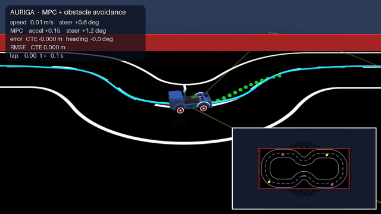
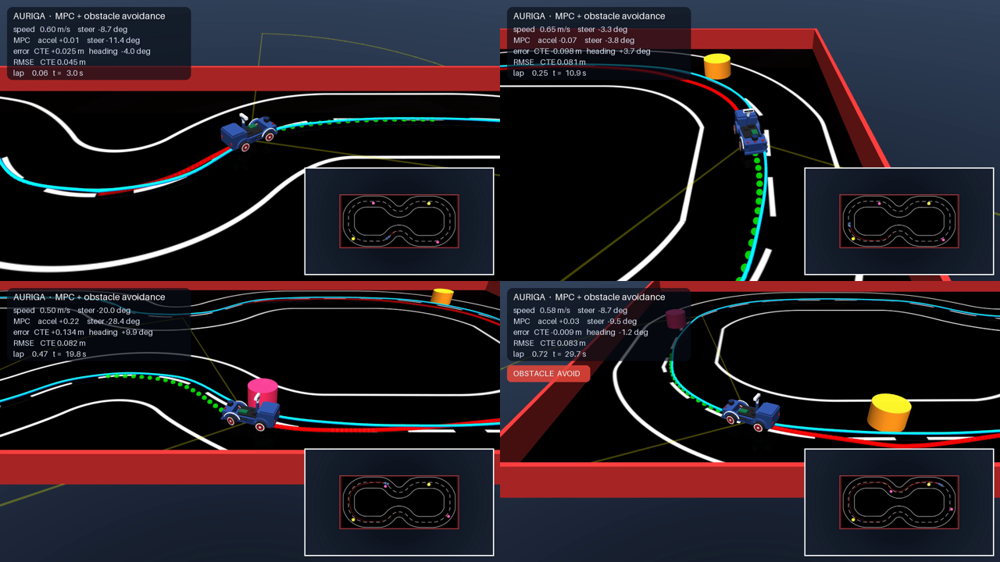
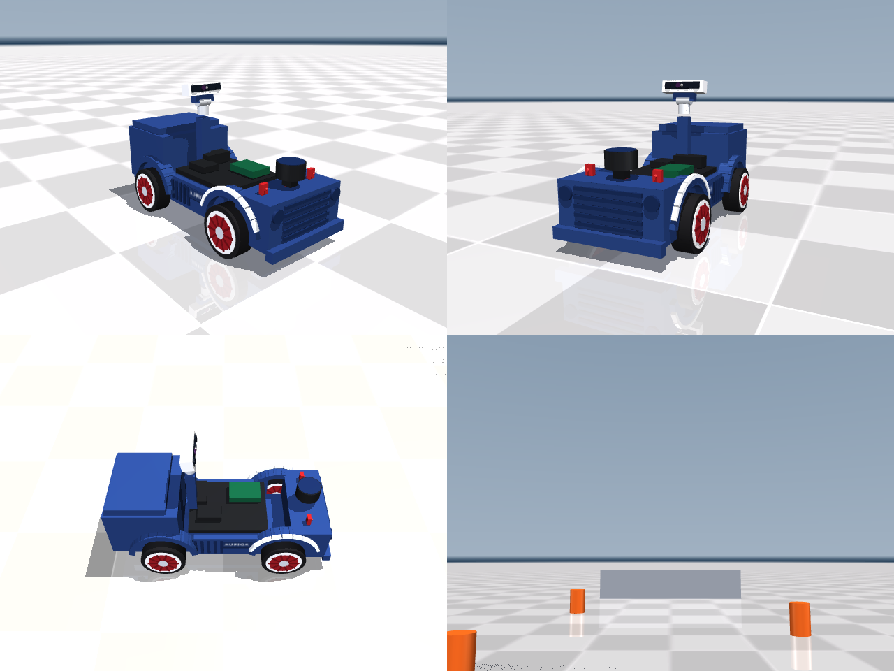
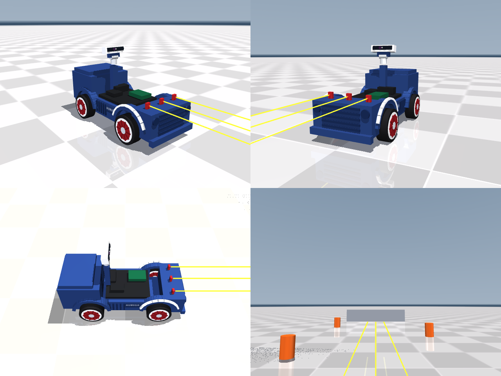
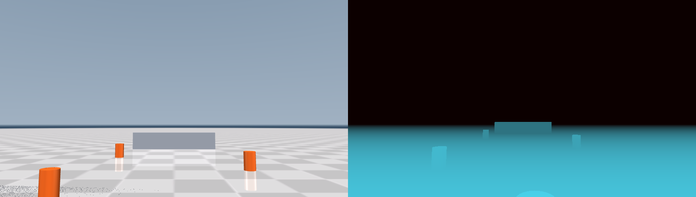
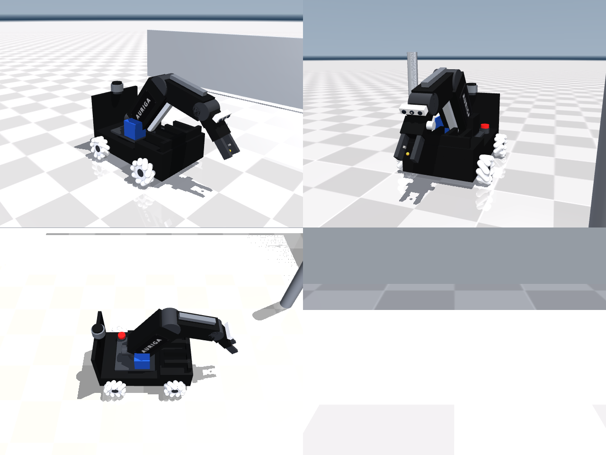
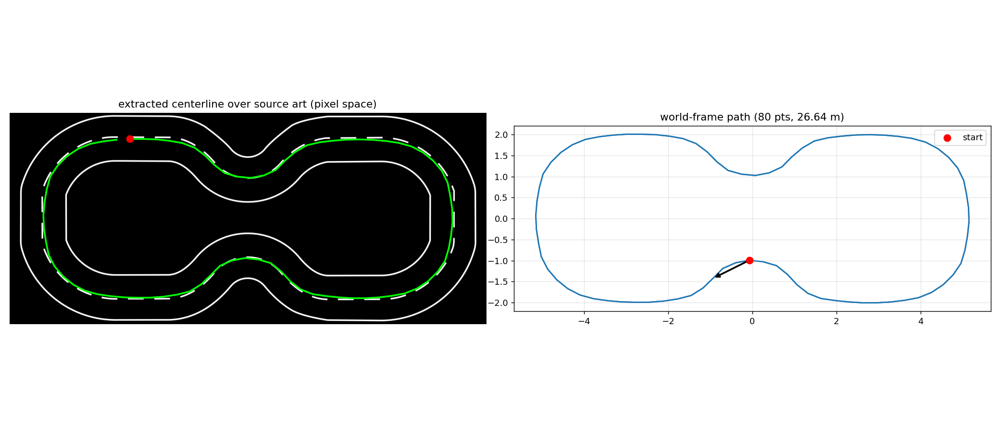
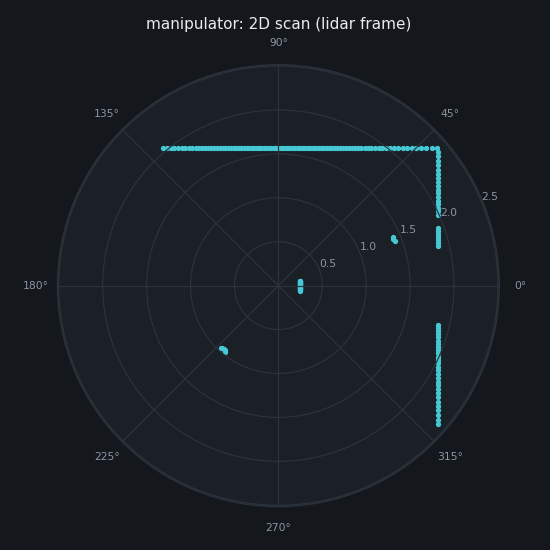
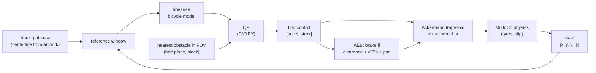

<div align="center">

# 🏎️ AURIGA — MPC Self-Driving Car

**Iterative Model Predictive Control with static + moving obstacle avoidance,<br>
on a fully-modelled Ackermann robot car in MuJoCo.**




<sub>🎬 Full-quality video: <a href="media/auriga_mpc_obstacle_avoidance.mp4"><b>media/auriga_mpc_obstacle_avoidance.mp4</b></a> &nbsp;·&nbsp;
<span style="color:#0099ff">blue</span> = reference centerline, <b>green dots</b> = MPC predicted horizon, <b>red</b> = driven trail,
<b>yellow wedge</b> = obstacle sensor FOV, <b>orange</b> = static obstacles, <b>magenta</b> = moving obstacles.</sub>

<sub>🙏 MPC core built on <a href="https://github.com/mcarfagno/mpc_python"><b>mcarfagno/mpc_python</b></a> — thank you! (see <a href="#-acknowledgements">Acknowledgements</a>)</sub>

</div>

---

## ✨ What's inside

| | |
|---|---|
| 🧠 **Iterative MPC** | Kinematic-bicycle MPC re-linearised every solve, formulated as a QP in CVXPY (Clarabel). 3 s horizon @ 0.15 s, rate limits on accel & steering. |
| 🚧 **Obstacle avoidance** | Static **and** moving obstacles, detected inside a 100° / 3 m "camera" FOV and pushed into the optimiser as a slack-penalised half-plane constraint. |
| 🛑 **AEB backstop** | Independent speed-dependent emergency brake that floors at a creep speed so the car can still steer *around* — never parks nose-to-obstacle forever. |
| 🛞 **Real Ackermann axle** | No drive plugin: each front knuckle gets its own angle from the steering trapezoid, the rear wheels are velocity-driven. Tyre slip and understeer come from contact physics. |
| 🗺️ **Track from artwork** | The reference path is the road centerline *extracted from the track artwork* (threshold → skeletonise → 80 waypoints → spline), so the car follows the drawn road. |
| 📷 **Sensors** | Pan/tilt RGB-D mast (D435-style colour + depth), 3× forward ToF rangefinders, 24-beam hood lidar + arbitrary-ray `mj_multiRay` scanner. |
| 🤖 **Two robots** | The AURIGA car *and* a mecanum-wheel mobile manipulator (36 free-spinning rollers, 4-DOF arm, parallel gripper). |
| 🧩 **ROS 2 too** | URDFs, Gazebo launch files, `ros2_control` config and a mecanum `cmd_vel` mixer. |

## 🎬 Demo — MPC + obstacle avoidance

<div align="center">

<br><sub>Key frames: line tracking · cornering · swerving around a moving obstacle · passing a static one</sub>
</div>

One full lap (26.6 m) of the peanut-shaped loop track with **2 static + 2 moving obstacles**.
The car tracks the road centerline at 0.6 m/s, sees an obstacle enter its sensor wedge,
bends its predicted horizon (green) around it, and merges back onto the line.
The inset in the bottom-right is a top-down view of the whole track with the driven trail.

**Results for the recorded lap** (deterministic, `python mpc/record_mpc_video.py`):

| metric | value |
|---|---|
| lap length / time | 26.6 m in 40.8 s (target 0.6 m/s) |
| cross-track error RMSE | **8.7 cm** on a ~1 m wide road |
| heading error RMSE | 5.1° |
| collisions | **0**: closest approach kept 4.5 cm clear of an obstacle edge |
| obstacle in sensor wedge | ~53 % of the lap |
| AEB backstop | engaged on 5 of ~2000 control ticks (the MPC handled the rest) |

Regenerate it yourself (headless, deterministic, no display needed):

```bash
MUJOCO_GL=egl python mpc/record_mpc_video.py            # GPU
MUJOCO_GL=osmesa python mpc/record_mpc_video.py --laps 2 # CPU only
```

## 🖼️ Gallery

<table>
  <tr>
    <td align="center"><br><sub>AURIGA car in MuJoCo</sub></td>
    <td align="center"><br><sub>ToF rangefinder rays</sub></td>
  </tr>
  <tr>
    <td align="center"><br><sub>Mast RGB-D stream</sub></td>
    <td align="center"><br><sub>Mecanum mobile manipulator</sub></td>
  </tr>
  <tr>
    <td align="center"><br><sub>Centerline extracted from the track art</sub></td>
    <td align="center"><br><sub>Lidar scan</sub></td>
  </tr>
</table>

## 🧮 How the controller works



**State** `x = [x, y, v, ψ]`, **input** `u = [a, δ]`, kinematic bicycle with wheelbase *L* = 0.26 m:

```
ẋ = v cos ψ     ẏ = v sin ψ     v̇ = a     ψ̇ = v tan δ / L
```

The QP minimises along-track / cross-track / speed / heading error plus input and input-rate cost
over the horizon, subject to `|v| ≤ 1.2 m/s`, `|a| ≤ 0.8 m/s²`, `|δ| ≤ 0.55 rad`, `|δ̇| ≤ 1 rad/s`.
The obstacle becomes a linear half-plane the predicted trajectory must stay on the far side of
(radius + half car width + 8 cm margin), softened by a heavily penalised slack so the problem
never goes infeasible. All weights live in [`mpc/mpc_car.yaml`](mpc/mpc_car.yaml).

The MPC's virtual-centre steering angle δ is turned into the two real knuckle angles:

```
R = L / tan δ      δ_in = atan(L / (R − T/2))      δ_out = atan(L / (R + T/2))      T = 0.196 m
```

## 🚀 Quick start

```bash
git clone https://github.com/KiaRational/MPC_Self_Driving_Car.git
cd MPC_Self_Driving_Car
pip install -r requirements.txt

python mpc/mpc_car.py              # 🏁 MPC + obstacle avoidance, interactive viewer (3 laps)
python sim/controller_car.py       # 🎮 drive it yourself (WASD) with a live sensor dashboard
python sim/demo_car.py             # cone lane, stops on the ToF return
python sim/realsense.py            # RGB + depth + point cloud from the D435 mast camera
python sim/lidar.py                # 2D / 3D lidar sweeps via mj_multiRay
python models/gen_mjcf.py          # regenerate the MJCF models from the source dimensions
```

Scripts resolve their models relative to the repo, so they run from any directory.
On macOS use `mjpython` instead of `python` for the passive viewer.

> ℹ️ The mecanum **manipulator** scripts (`sim/demo_manipulator.py`, and the `manipulator` mode of
> `realsense.py` / `lidar.py`) expect `models/scene_manipulator.xml`, which isn't in the repo yet.
> `python models/gen_mjcf.py` regenerates the robot (`auriga_manipulator.xml`), but the scene
> wrapper still needs adding.

## 📁 Repository layout

```
MPC_Self_Driving_Car/
├── mpc/                          ⭐ the controller
│   ├── mpc_car.py                   iterative MPC + obstacle avoidance on the AURIGA car
│   ├── mpc_car.yaml                 vehicle limits, horizon, cost weights, obstacle margin
│   ├── record_mpc_video.py          headless, deterministic recorder -> media/*.mp4 + *.gif
│   └── track_path.csv               road centerline extracted from the track artwork
├── sim/                          MuJoCo demos & sensors
│   ├── controller_car.py            keyboard teleop + autopilot, RGB / depth / lidar dashboard
│   ├── demo_car.py                  cone lane + ToF stop; also the shared Ackermann helper
│   ├── demo_manipulator.py          mecanum base + arm demo
│   ├── realsense.py                 D435-style RGB-D + point cloud
│   └── lidar.py                     2D / 3D scans via mj_multiRay
├── models/                       MJCF models
│   ├── gen_mjcf.py                  source of truth -> auriga_car.xml (+ manipulator)
│   ├── auriga_car.xml               Ackermann car, pan/tilt mast, ToF, lidar
│   ├── scene_car.xml                track floor (artwork texture), walls, lights
│   ├── scene_mpc.xml                scene_car + 4 mocap obstacles
│   └── assets/                      track texture, nameplate textures + UV-mapped plates
├── ros2/                         ROS 2 / Gazebo descriptions
│   ├── auriga_car_description/      car URDF, generate_urdf.py, gazebo.launch.py
│   └── auriga_description/          manipulator URDF, spawn launch, controllers, mecanum mixer
├── third_party/mpc_python/       vendored cvxpy_mpc library (MIT, see credits)
├── media/                        demo video
└── docs/                         MUJOCO.md, URDF_ROS2.md, images
```

Deeper notes on the models (measured mecanum/Ackermann behaviour, sensor setup, MuJoCo quirks)
are in [`docs/MUJOCO.md`](docs/MUJOCO.md) and [`docs/URDF_ROS2.md`](docs/URDF_ROS2.md).

## 🛠️ Tuning tips

- **Hugging the line too loosely?** Raise the cross-track weight (2nd entry of `state_cost`).
- **Twitchy steering?** Raise `input_rate_cost`, or lower `max_d_steer`.
- **Clipping obstacles?** Increase `obstacle.safety_margin` or `SENSOR_MAX_RANGE` in `mpc/mpc_car.py`
  so the obstacle enters the horizon earlier.
- **Want it faster?** `TARGET_SPEED` in `mpc/mpc_car.py`, then `max_speed` / `max_acc` in the YAML —
  expect more tyre slip in the tight chicanes (the model is kinematic; the physics is not).
- Move / add obstacles in the `OBSTACLES` list: position is a fraction of a lap, lateral offset is
  metres from the centerline, `speed ≠ 0` makes it move along the road.

## 🙏 Acknowledgements

A huge thank-you to **[mcarfagno](https://github.com/mcarfagno)** for
[**mpc_python**](https://github.com/mcarfagno/mpc_python) ⭐ — a clear, well-documented iterative-MPC
tracking controller built on CVXPY and MuJoCo. Its `cvxpy_mpc` package (code vendored unmodified in
[`third_party/mpc_python/`](third_party/mpc_python), MIT-licensed — see its
[`LICENSE`](third_party/mpc_python/LICENSE)) is the optimiser at the heart of this project, and
`mpc/mpc_car.py` started life as a port of its `mpc_demo_mujoco.py` onto the AURIGA car and track.
Go check out the original repo, its notebooks, and give it a star!

mpc_python in turn credits these works, which are worth reading too:

- [Prof. Borrelli — kinematic MPC paper](https://borrelli.me.berkeley.edu/pdfpub/IV_KinematicMPC_jason.pdf)
- [AtsushiSakai — PythonRobotics](https://github.com/AtsushiSakai/PythonRobotics/)
- [alexliniger — MPCC](https://github.com/alexliniger/MPCC) and the [paper](https://onlinelibrary.wiley.com/doi/abs/10.1002/oca.2123)
- [arex18 — rocket-lander](https://github.com/arex18/rocket-lander)
- [prl-mushr — mushr_mujoco_ros](https://github.com/prl-mushr/mushr_mujoco_ros) (the MuSHR car model in `third_party/mpc_python`)

Built with [MuJoCo](https://mujoco.org) · [CVXPY](https://www.cvxpy.org) · [Clarabel](https://clarabel.org).

## 📄 License

The vendored `mpc_python` library is MIT-licensed (see its LICENSE). No license has been chosen yet for the rest of this repository.
